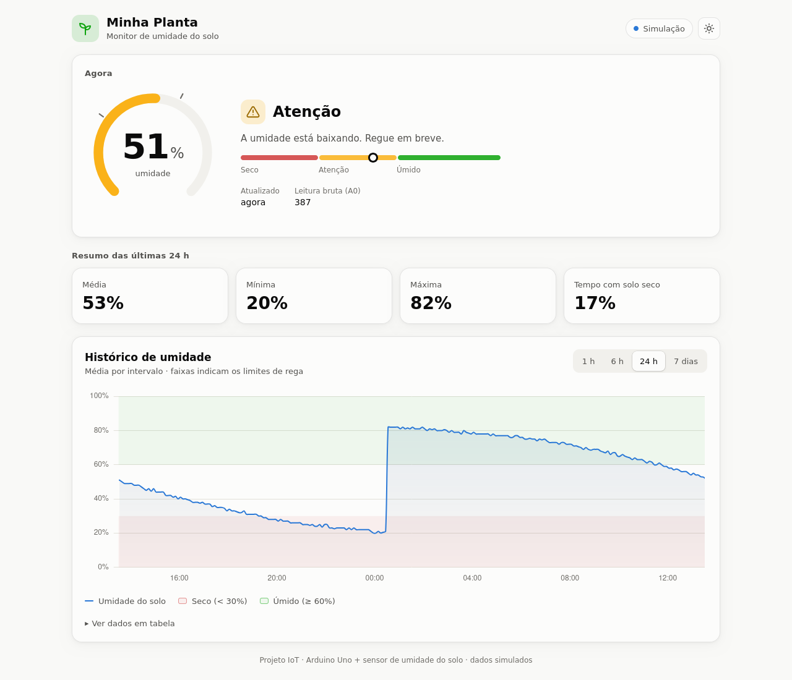
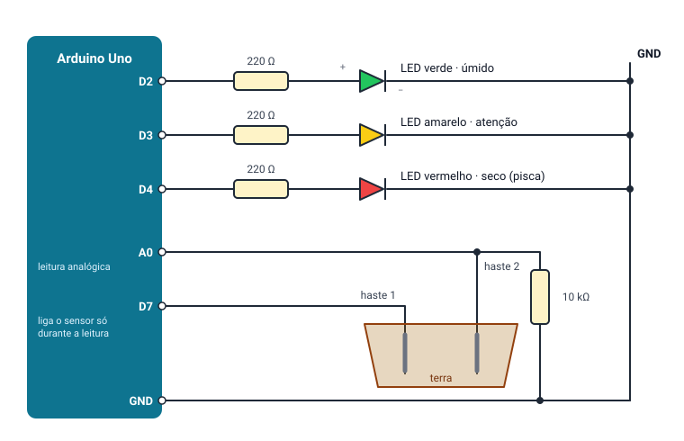
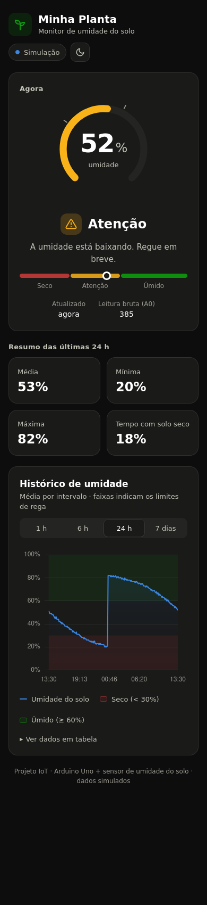

# 🌱 Sensor de Umidade do Solo — Arduino Uno + Dashboard Web

Projeto da disciplina de **IoT**: um Arduino Uno mede a umidade do solo de uma planta,
avisa com LEDs quando ela precisa de água e envia as leituras para um
**dashboard web** que pode ser aberto de qualquer celular ou computador da mesma rede.



## Como funciona

```
[Sensor de umidade] → [Arduino Uno] ──USB/Serial (JSON)──> [PC: servidor Python] ──Wi-Fi──> [Celular / Notebook]
                        LEDs de estado                       SQLite (histórico)            http://IP-DO-PC:5000
```

1. O **Arduino** lê o sensor a cada 2 s (média de 10 amostras), converte para 0–100 %,
   classifica o estado (seco / atenção / úmido, com histerese) e acende o LED correspondente.
   Cada leitura é enviada pela Serial como JSON:
   `{"raw":412,"umidade":47,"estado":"atencao"}`
2. O **servidor Python** (gateway) lê a Serial, guarda as leituras em SQLite e publica a
   API e o dashboard na rede local.
3. O **dashboard** mostra a umidade atual, o estado da planta, o resumo do período
   (média, mínima, máxima, % do tempo seco) e o gráfico histórico (1 h, 6 h, 24 h, 7 dias).

Os LEDs funcionam sozinhos, mesmo sem o PC. Dá para alimentar o Arduino com uma bateria de
9 V (o conector vem no kit) e deixá-lo junto da planta.

## Materiais

Tudo abaixo vem no **Kit Arduino Uno R3** básico, **exceto as hastes**, que podem ser
pregos ou fio rígido.

| Componente | Qtd. | Uso |
|---|---|---|
| Arduino Uno R3 + cabo USB | 1 | Controlador e comunicação com o PC |
| Protoboard 400 pontos + jumpers | 1 | Montagem |
| LEDs | 3 | Estado: úmido, atenção, seco |
| Resistor 220 Ω | 3 | Um para cada LED |
| Resistor 10 kΩ | 1 | Divisor de tensão do sensor |
| 2 hastes metálicas (pregos galvanizados ou fio rígido) | 2 | Sensor caseiro de umidade |
| Conector de bateria 9 V | 1 | Opcional: funcionar sem o PC |

> O ideal é usar LEDs **verde, amarelo e vermelho**. Se o seu kit tiver outras cores, use o
> que tiver: o LED de "seco" (D4) **pisca**, então dá para distinguir mesmo com cores iguais.

**Upgrades opcionais**, que não vêm no kit:
- **Sensor capacitivo v1.2** (cerca de R$ 15): mais preciso e não corrói. Basta ligar e recalibrar.
- **Buzzer ativo 5 V** no D5: alarme sonoro quando o solo seca. O código já está pronto.

## Ligações



| Ligação | Detalhe |
|---|---|
| **D7 → haste 1** | Alimenta o sensor só durante a leitura, para evitar corrosão |
| **Haste 2 → A0** | Leitura analógica |
| **A0 → resistor 10 kΩ → GND** | Divisor de tensão, sem ele a leitura flutua |
| **D2 → 220 Ω → LED verde → GND** | Solo úmido |
| **D3 → 220 Ω → LED amarelo → GND** | Atenção |
| **D4 → 220 Ω → LED vermelho → GND** | Seco (pisca) |

A perna **longa** do LED (+) vai para o lado do resistor, e a **curta** (−) vai para o GND.
Enterre as hastes a 2–3 cm uma da outra. Detalhes e calibração estão em
[docs/calibracao.md](docs/calibracao.md).

## Estrutura do repositório

```
├── arduino/sensor_umidade/sensor_umidade.ino   firmware do Arduino
├── servidor/
│   ├── app.py              gateway: Serial → SQLite → API + dashboard
│   ├── requirements.txt
│   └── static/             dashboard (HTML, CSS, JS + Chart.js local)
├── simulacao/diagram.json  circuito para o simulador Wokwi
└── docs/                   calibração e imagens
```

## Como rodar

### 1. Arduino

1. Abra `arduino/sensor_umidade/sensor_umidade.ino` na **Arduino IDE**.
2. Selecione **Placa: Arduino Uno** e a porta correta, depois clique em **Carregar**.
3. Faça a [calibração](docs/calibracao.md) (2 minutos, recomendado).
4. **Feche o Monitor Serial** antes de iniciar o servidor, porque só um programa pode usar a porta de cada vez.

### 2. Servidor + dashboard

Requer Python 3.9+.

```bash
cd servidor
python -m venv .venv
source .venv/bin/activate          # Windows: .venv\Scripts\activate
pip install -r requirements.txt

python app.py                      # detecta o Arduino automaticamente
```

Se a porta não for detectada, informe-a manualmente:

```bash
python app.py --porta /dev/ttyACM0   # Linux
python app.py --porta COM3           # Windows (veja em Gerenciador de Dispositivos)
```

> **Linux:** se aparecer "Permission denied", rode `sudo usermod -aG dialout $USER` e faça logout/login.

### 3. Acessar pelo celular

Ao iniciar, o servidor mostra os endereços:

```
  Dashboard:  http://localhost:5000
  Na rede:    http://192.168.0.15:5000   <- abra no celular (mesmo Wi-Fi)
```

Abra o endereço **"Na rede"** em qualquer dispositivo conectado ao mesmo Wi-Fi.
Se não abrir, libere a porta 5000 no firewall do PC. No Windows, aceite o aviso do
firewall na primeira execução e marque **"Redes privadas"**.

## Modo simulação (sem Arduino)

Para testar ou apresentar sem o hardware:

```bash
python app.py --simular
```

O servidor gera 7 dias de histórico fictício e continua produzindo leituras ao vivo, com o
solo secando rápido e sendo "regado" automaticamente. Os dados ficam em `umidade_sim.db`,
separados dos dados reais (`umidade.db`).

### Simulando o circuito no Wokwi

1. Acesse <https://wokwi.com/projects/new/arduino-uno>.
2. Cole o conteúdo de `sensor_umidade.ino` na aba `sketch.ino`.
3. Na aba `diagram.json`, cole o conteúdo de `simulacao/diagram.json`.
4. Clique em ▶. O **potenciômetro** faz o papel do sensor, alimentado pelo D7 como as hastes
   reais. Gire-o e veja os LEDs e o JSON no Monitor Serial mudarem.

## API

| Rota | Descrição |
|---|---|
| `GET /` | Dashboard |
| `GET /api/atual` | Última leitura, se o sensor está online e os limites |
| `GET /api/historico?horas=24` | Pontos agregados para o gráfico e o resumo do período |

Exemplo de `/api/atual`:

```json
{
  "leitura": {"ts": 1790785728.8, "raw": 380, "umidade": 54, "estado": "atencao"},
  "online": true,
  "idade_s": 0.4,
  "modo": "serial",
  "limites": {"seco": 30, "umido": 60}
}
```

## Dashboard no celular



- Tema claro e escuro (segue o sistema ou o botão no topo)
- Layout responsivo para celular, tablet e desktop
- Estado da planta indicado por cor, ícone **e** texto, sem depender só da cor
- Gráfico com faixas de "seco" e "úmido", tooltip ao passar o dedo/mouse e tabela com os dados
- Aviso de **"Sensor offline"** quando as leituras param de chegar
- Funciona sem internet (Chart.js está incluído no projeto)
